# ContextCue

**A spoiler-proof AI viewing companion for Fire TV.** Pause anything, ask "who is that?" or
"catch me up" or "why did she do that?" — get an answer grounded only in dialogue that has
already played. Nothing after the playhead ever reaches the model, and the film's title is
withheld from it by default, so it can't fall back on what it already knows about a famous story.

Built for Amazon's **Build, Ship, Shape** hackathon (Fire TV track).

## Live demo & key links

| | |
|---|---|
| Demo video (2:07) | https://youtu.be/P4I7SLnB_Jc |
| Live API (AWS Lambda + API Gateway, Bedrock Claude Haiku 4.5) | https://8ctx9nuzjk.execute-api.us-east-1.amazonaws.com (`/health`, `/v1/titles`, `/v1/ask`, `/mcp`) |
| Phone companion | https://8ctx9nuzjk.execute-api.us-east-1.amazonaws.com/companion/ |
| Vega integration (fork of Amazon's `react-native-multi-tv-app-sample`) | https://github.com/mihirjoshi21/react-native-multi-tv-app-sample/tree/contextcue-spoiler-safe-qa |
| Upstream-ready Vega build fixes for that sample | https://github.com/mihirjoshi21/react-native-multi-tv-app-sample/tree/upstream-vega-build-fixes |

Try it yourself (no credentials needed). Ben's name isn't spoken until 54:34:

```bash
API=https://8ctx9nuzjk.execute-api.us-east-1.amazonaws.com
ask() { curl -s -X POST $API/v1/ask -H 'content-type: application/json' \
  -d "{\"titleId\":\"night-of-the-living-dead-1968\",\"positionMs\":$1,\"question\":\"$2\"}"; }
ask 1200000 "Who is the man who boarded up the house?"   # 20:00 -> "hasn't been revealed yet"
ask 3300000 "Who is the man who boarded up the house?"   # 55:00 -> "Ben ... [23:15] we have to try to board the house up together"
ask 1200000 "Does Ben survive the night?"                # -> "That hasn't been revealed yet."
```

### Running on Vega OS (official Vega Virtual Device), inside Amazon's own sample app

| | | |
|---|---|---|
| 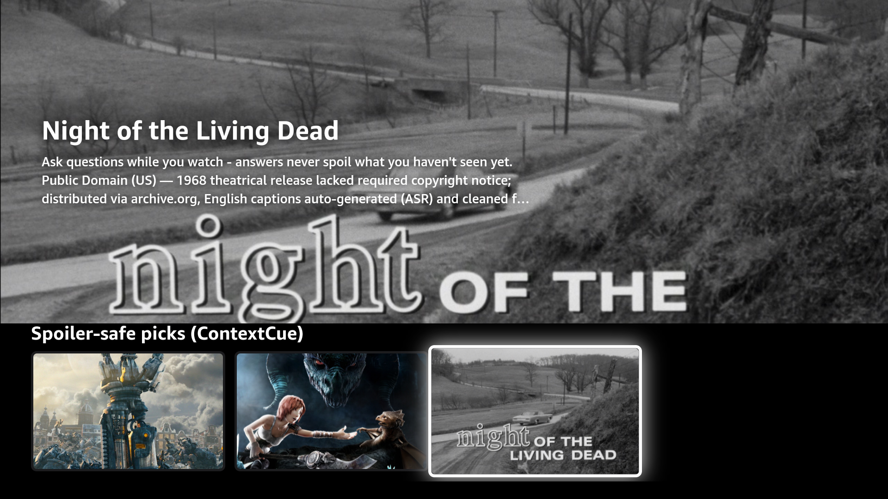 | 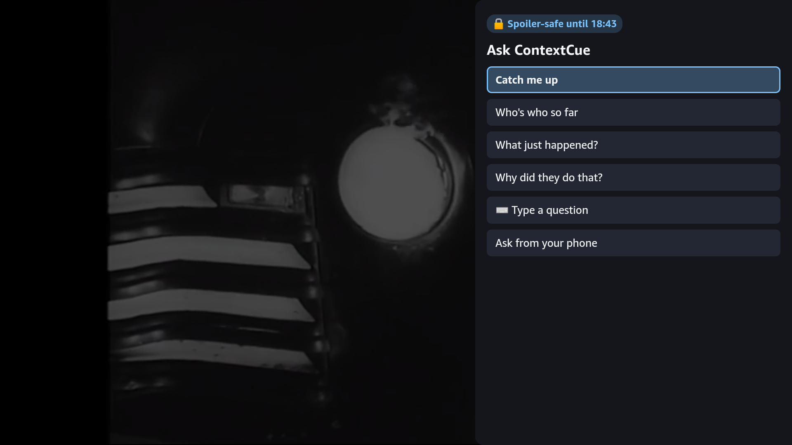 | 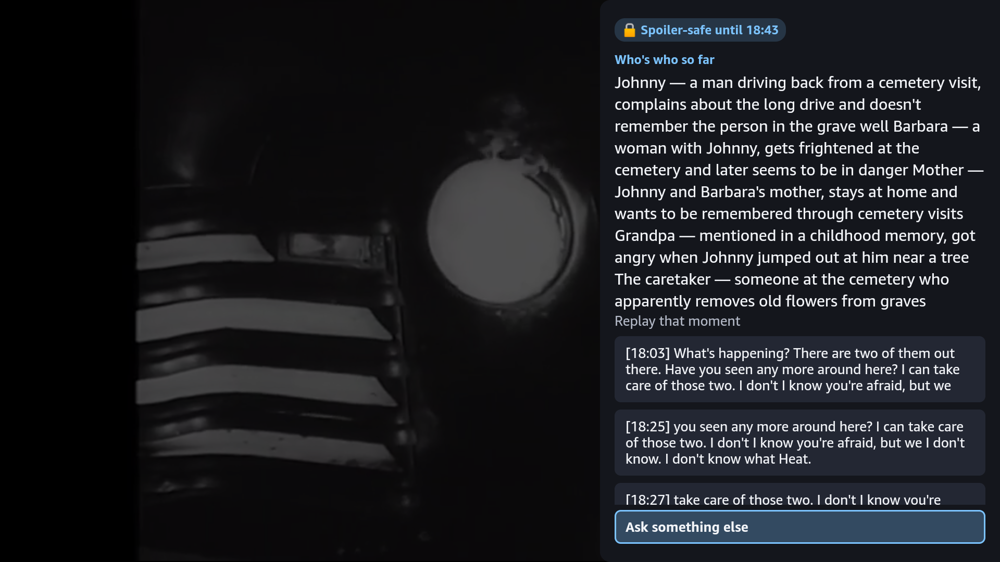 |
| "Spoiler-safe picks (ContextCue)" row, loaded from the live API | Press **Up** in the player: Ask panel with the 🔒 *Spoiler-safe until 18:43* badge | Real Claude answer at 18:43; the rescuer's name (spoken at 54:34) is correctly *not* revealed |

### Drop-in SDKs
- **React Native (Fire OS + Vega):** [`packages/react-native-tv`](packages/react-native-tv): `useContextCue` + `<ContextCueAskButton>` + `<ContextCueOverlay>`, about 20 lines to integrate.
- **Kotlin / Compose for TV (Fire OS):** [`apps/firetv-android/contextcue-sdk`](apps/firetv-android/contextcue-sdk): `rememberContextCueController` + `ContextCueOverlay`; the `app` module is the reference ExoPlayer host.

## Why it matters

- **People already do this badly.** Viewers reach for their phone mid-episode to Google "who is
  that guy" or rewind three times to re-follow a scene — a second screen full of live spoilers for
  a problem the TV itself could answer safely.
- **Accessibility, broadly defined.** Viewers with memory or attention differences, second-language
  viewers who lose a thread of dialogue, and kids watching with a parent all benefit from an
  on-demand, judgment-free "catch me up" that never punishes them with a plot reveal for asking.
- **Binge-watchers returning after days (or months).** "What happened last time?" is currently
  answered by recap montages (if the show bothers) or by re-watching cold. A one-button, spoken
  recap that stops exactly at *your* current point solves this without spoiling anything past it.

## Screenshots

All real, captured from a live run against the mock provider (`docs/screenshots/`) — none of these
are mockups.

| | |
|---|---|
| 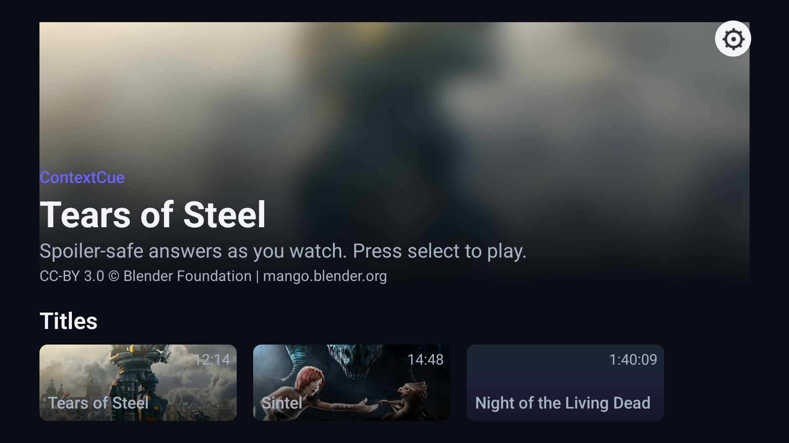 | Fire TV home screen — title rows (Tears of Steel, Sintel, Night of the Living Dead), 10-foot UI, D-pad focus states. |
| 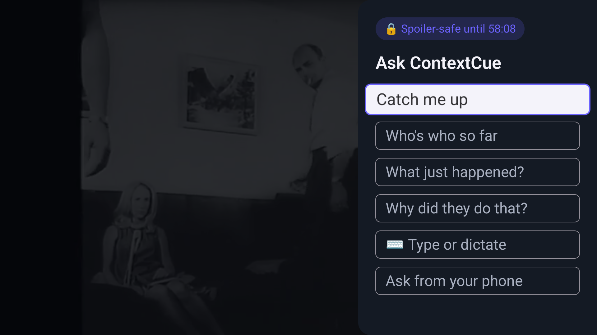 | Player paused, Ask panel open: canned chips ("Catch me up", "Who's who so far", "What just happened?", "Why did they do that?"), a "Type or dictate" free-text chip, "Ask from your phone", and the "Spoiler-safe until 58:08" badge. |
| 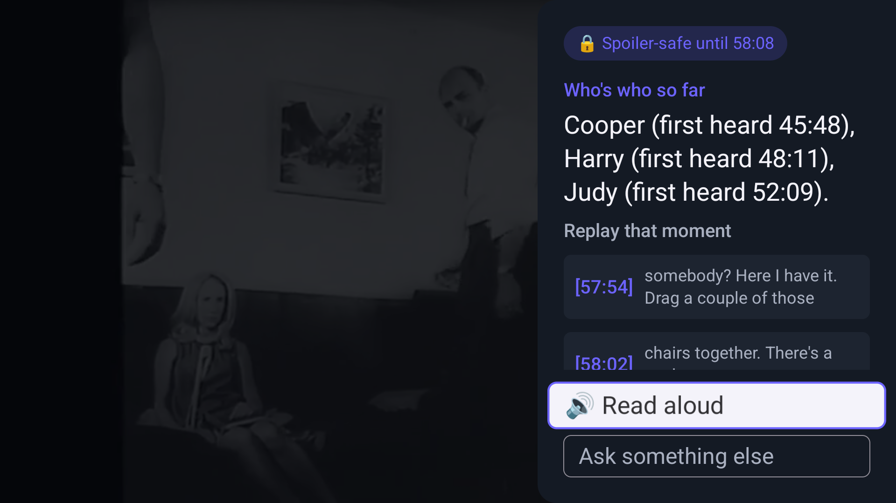 | "Who's who so far" answer — names with first-heard timestamps, plus tappable `[57:54]`-style citations under "Replay that moment" that seek back to the exact line, and a "Read aloud" (Polly) chip. |
| 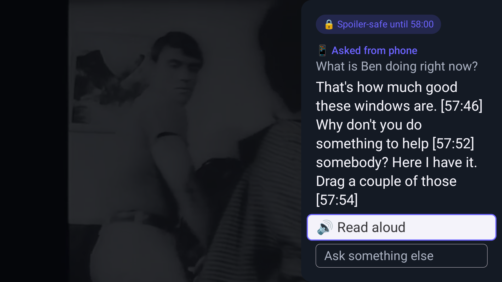 | A question asked from a paired phone ("📱 Asked from phone: What is Ben doing right now?") shown on the TV via the `showOnTv` "Show on TV" flow. |
| 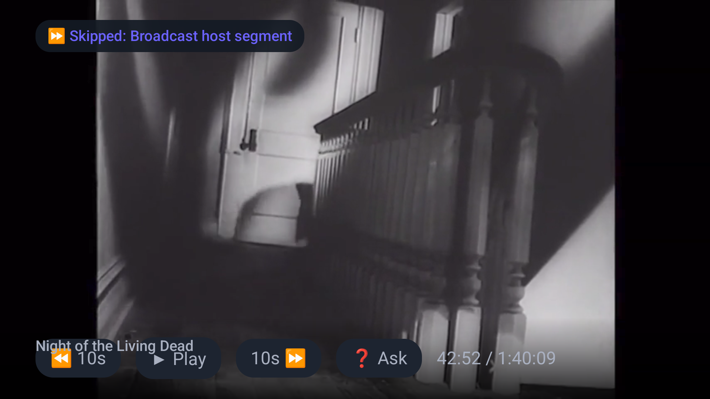 | Auto-skip in action: a non-story broadcast-host segment baked into the archive.org video is jumped over mid-playback, with a "⏩ Skipped: Broadcast host segment" toast. |
| 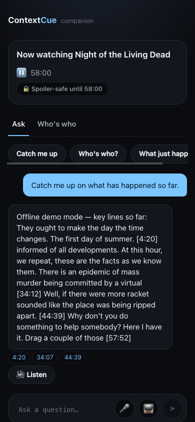 | Phone companion: "Now watching Night of the Living Dead" header, quick-chip row, a "Catch me up" answer (clearly labeled "Offline demo mode" when running against the mock provider), tappable citation chips, Listen, and the question composer. |
| 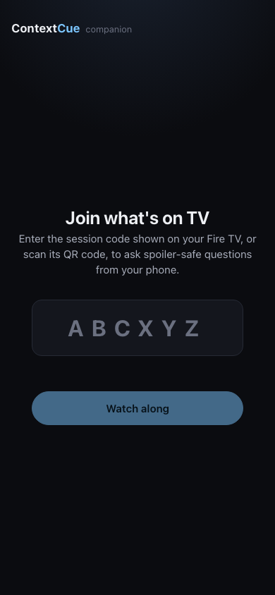 | Phone companion: "Join what's on TV" — 6-character session code entry (or QR scan) to pair with the TV. |
| Also in `docs/screenshots/`: `companion-whoswho.png`, `firetv-ask-recap.png`, `firetv-ask-typed-answer.png`, `firetv-type-question.png`, `firetv-qr-panel.png` | Additional captures of the same flows (typed questions, recap, QR pairing panel, who's-who on the companion). |

## Evals

`evals/` is a standalone spoiler-leak evaluation harness (deliberately not an npm workspace member —
see [Evals](#evals)) that proves the headline claim over HTTP, the same way a
real client would: **31 cases** (26 Night of the Living Dead, 5 Tears of Steel) across `trap`
(same question at several positions before a reveal — must withhold every time), `grounded` (same
question just after the reveal — must actually answer), `who`, `recap`, and `injection` categories.
Every `mustNotContain`/`shouldMention` fact is independently re-verified against the raw `.srt` files
by `evals/scripts/verify-cases.mjs`, not hand-typed from memory of the films.

**Latest real-model run** (`evals/results/latest.md`, Claude Haiku 4.5 on Amazon Bedrock, graded by Claude Sonnet 4.5): **31/31 requests succeeded, 0 mechanical leak failures, 0 citation-safety violations, 85% grounded recall**, p50/p95 latency 3.3 s / 5.0 s. The grader sees both the past and the future dialogue and flagged 4 claims. We checked each one by hand against the subtitle file and none revealed future events: two were grader errors (the cited lines had already played), and two were the model naming the wrong character for a speaker-less line, which a later prompt change reduced. The report lists each flagged claim with its evidence. See [`evals/README.md`](evals/README.md).

## Security model

- **Session write authentication (`tvToken`)**: `POST /v1/sessions` returns `{code, tvToken}` once;
  only the 24+ byte `tvToken` (never persisted in plaintext — only its SHA-256 hash, compared with
  a constant-time check) authorizes `PUT /v1/sessions/:code` (position/title/playing updates). The
  shareable 6-char `code` alone is enough for read/ask, since asking questions or pushing a
  "show on TV" answer isn't the privileged operation — changing what the TV is playing, or where, is.
- **Locale validated at two layers**: an HTTP-boundary regex check, plus a defensive re-check inside
  `core.buildPrompt` itself, so a malformed `locale` (a plausible prompt-injection vector into the
  system prompt) is rejected or silently dropped rather than ever reaching the model.
- **`skipRanges` are treated exactly like future cues**: a broadcast-host segment spliced into a
  title's video is filtered out of the cue list *before* context building, retrieval, or the
  characters heuristic ever see it — not just skipped in the player UI.
- **Poster filenames** are checked against a strict allow-list regex before ever reaching a content
  store — no path traversal, no arbitrary file reads.
- **API Gateway throttling** (20 rps / 40 burst by default, configurable) as a coarse backstop
  against a runaway client; a documented (not provisioned) WAF rate-based rule is the recommended
  next step for real per-IP abuse protection.
- **Optional Bedrock Guardrails** (`-c withGuardrail=true`): a kids-mode content-filter guardrail: an
  intervention returns the same safe fallback string the spoiler guard uses, never the model's raw
  blocked output.
- Full detail (including the two CRITICAL-severity gaps found and fixed in a dedicated security
  review round — an unauthenticated session-write bypass, and a title/session mismatch on the
  characters endpoint) is in [`docs/architecture.md`](docs/architecture.md#security).

## How it works: two-layer spoiler defense

The pitch's entire technical story is that spoiler-safety is *structural*, not a prompt request the
model can ignore.

1. **Hard timestamp ceiling.** The server only ever loads subtitle cues whose `startMs <= positionMs`
   (the current playhead). This isn't a filter applied after the fact — the future literally isn't
   present in the data structure handed to the model. Asserted in code (throws, not logs) in two
   independent places in `@contextcue/core`, and exercised with property-based tests across random
   subtitle sets and random playback positions (see [`docs/architecture.md`](docs/architecture.md)).
2. **Knowledge-leak guard, defense in depth.** Two more failure modes remain even with a perfect
   ceiling: the model's own world knowledge of a story it recognizes, and it inferring/speculating
   ahead of what's been shown. So:
   - **Title withholding** (`withholdTitle: true`, default): the model is never told what film it's
     watching — only anonymous dialogue — so it has nothing to pattern-match against.
   - **System-prompt instructions**: answer only from the supplied transcript, never use outside
     knowledge of the story even if it's recognized, never speculate about what's coming.
   - **Post-answer guard** (`spoilerGuard`): scans the model's own answer for future-tense/spoiler
     phrasing ("eventually", "turns out", "in the end"), timestamps cited past the playhead, and
     proper nouns that don't appear anywhere in the transcript actually shown — and strips the
     offending sentences before the answer ever reaches a viewer.
   - **Citations have their own independent safety net** on top of the guard — a citation past the
     safe position is never returned, even if a bug elsewhere let one through.

A companion phone can never ask further than the TV has actually played, either: when a session
code is given, the server clamps to `min(client-claimed position, session's actual TV position)`.

Answers can also stream (`POST /v1/ask/stream`, Server-Sent Events) for a faster perceived response
on longer recaps — the shared streaming pipeline buffers model output into complete sentences and
runs the spoiler guard on *each sentence before it's ever emitted*, so a flagged sentence is dropped
silently rather than sent then retracted. Every "31 cases" eval below runs against the same guarded
pipeline, not a separate/looser one.

## Architecture

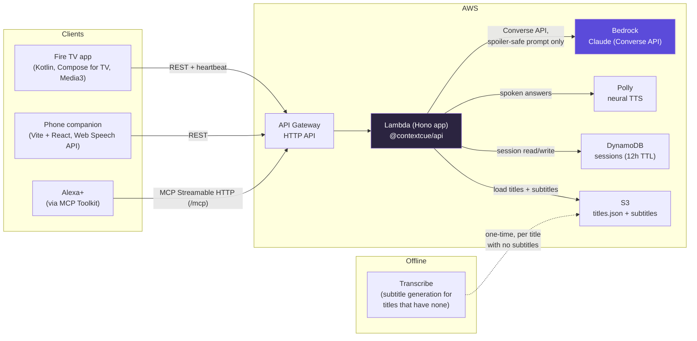

`@contextcue/core` (the box doing the actual spoiler-safety work — windowing, retrieval, prompt
building, guard) is a standalone MIT library that both the local dev server and the Lambda import
identically; see [`packages/core/README.md`](packages/core/README.md).

## Repo map

```
/package.json               npm workspaces root (packages/*, services/*, apps/companion)
/SPEC.md                    build spec — source of truth for every package's contract
/packages/core              @contextcue/core — MIT, zero-runtime-dep spoiler-safety library
/services/api               @contextcue/api — Hono app; runs as local Node server AND as AWS Lambda; /mcp mounted here
/infra                      AWS CDK v2 app (TypeScript) — S3, DynamoDB, Lambda, API Gateway HTTP API
/apps/companion             Vite + React phone companion web app (served by the API at /companion in prod)
/apps/firetv-android         Kotlin + Jetpack Compose for TV + Media3 ExoPlayer Fire TV app (Gradle)
/content                    titles.json + subtitles (.srt); videos are NOT committed (streamed from archive.org URLs; see content/ATTRIBUTION.md)
/evals                      standalone spoiler-leak evaluation harness (HTTP black-box, not a workspace member — see evals/README.md)
/docs                       architecture, friction log, screenshots
```

## Quickstart (offline, no AWS needed)

```bash
git clone <this-repo>
cd contextcue           # or whatever the clone directory is named
npm install              # installs every workspace from the root
npm run build            # builds packages/core (services/api & the companion import its dist/ output)
PROVIDER=mock npm run dev -w @contextcue/api
# -> http://localhost:8787  (health check: curl localhost:8787/health)
```

`PROVIDER=mock` is the default — the whole backend works with **zero AWS credentials**: a
deterministic, extractive "AI" answers from the retrieved subtitle cues, so the demo runs fully
offline. See [`services/api/README.md`](services/api/README.md) for every endpoint and env var.

**Companion (phone web app), in a second terminal:**

```bash
npm run dev -w @contextcue/companion
# -> http://localhost:5173, proxies /v1/* to the api dev server above
```

**Fire TV app (build the APK, run on an emulator or sideload to a real Stick):**

```bash
cd apps/firetv-android
./gradlew assembleDebug
# APK at app/build/outputs/apk/debug/app-debug.apk

# No official Fire TV emulator exists (Amazon's own docs recommend physical-device
# testing) — a standard Android TV AVD is the documented stand-in:
#   Android Studio -> Tools -> Device Manager -> Create Device -> "TV" -> API 28 or 30
# The app's default API base URL (10.0.2.2:8787) already targets the AVD's host-loopback
# alias to the api dev server above.
./gradlew installDebug   # once an emulator/device is running or connected via adb
```

To sideload to a **real** Fire TV Stick instead: enable ADB debugging + apps from unknown
sources under Settings → My Fire TV → Developer Options, then
`adb connect <fire-tv-ip>:5555 && adb install app/build/outputs/apk/debug/app-debug.apk`.
(Note: some of the newest 2025–2026 Fire TV Stick models ship on Vega OS, not Android, and cannot
sideload a Kotlin APK — confirm the demo hardware is an Android-based Fire OS device first. See
the Amazon developer docs.)

## Deploy to AWS

```bash
npm run build -w @contextcue/api      # bundles services/api/dist/lambda.mjs — the CDK stack
                                       # fails fast with a clear error if you skip this
cd infra
npm install                            # infra has its own dependency tree, not a workspace
aws sso login                          # or set AWS_PROFILE — needs deploy permissions + one-time `cdk bootstrap`
npx cdk bootstrap                      # once per account/region
npx cdk deploy
```

Outputs: `ApiUrl` (point the Fire TV app / companion at this), `McpUrl` (`ApiUrl` + `/mcp`, point
Alexa+ or any MCP client at this), `ContentBucketName`, `SessionsTableName`.

`npx cdk synth` (template generation only, no deploy, no credentials needed) is verified working
in this repo as committed. See [`infra/README.md`](infra/README.md) for what's provisioned, IAM
grants, and a cost estimate (full hackathon-scale demo: well under $5).

**Generating subtitles for a title that has none** (a real Transcribe integration, not just a demo
prop): `npx tsx infra/scripts/transcribe-subtitles.ts --bucket <some-s3-bucket> --wait` — uploads
video, runs `StartTranscriptionJob` with SRT output, patches `titles.json`. See
[`docs/architecture.md`](docs/architecture.md) for details.

## Tracks & challenges entered

- **Primary: Fire TV** — runs as a sideloadable Android APK on Fire OS (Fire TV Stick / emulator),
  hitting the "AI-enhanced viewing, family entertainment, multi-modal UX" priority categories.
- **Mini: AWS Builder** — real, documented code paths for Bedrock (Converse API, prompt caching,
  optional Guardrails), Lambda, API Gateway HTTP API (with throttling), DynamoDB, S3, Polly,
  Transcribe, CDK, and CloudWatch EMF metrics. See
  [`docs/architecture.md`](docs/architecture.md) for the exact integration list.
- **Mini: Open Source** — `packages/core` is a standalone, zero-runtime-dependency MIT library.
- **Bonus ecosystem reach (not a separate track prize claim):** an MCP server (spec `2025-11-25`,
  Streamable HTTP) at `/mcp` so Alexa+ can answer "Alexa, who's that guy?" about what's playing on
  the TV. It is scoped as a bonus rather than the
  Alexa+ track entry.

## License & content attribution

Code is MIT licensed — see [`LICENSE`](LICENSE) (also mirrored in
[`packages/core/LICENSE`](packages/core/LICENSE) so the standalone library carries its own copy).

Demo content (video/subtitles/posters) is **not** covered by the MIT license above — each title has
its own license (two CC-BY 3.0 Blender Foundation shorts, one US public-domain feature). Full
sourcing, license text, and required attribution for every title is in
[`content/ATTRIBUTION.md`](content/ATTRIBUTION.md). Video files are not committed to the repo (see
`content/titles.json` for source URLs); only subtitle text is checked in.
